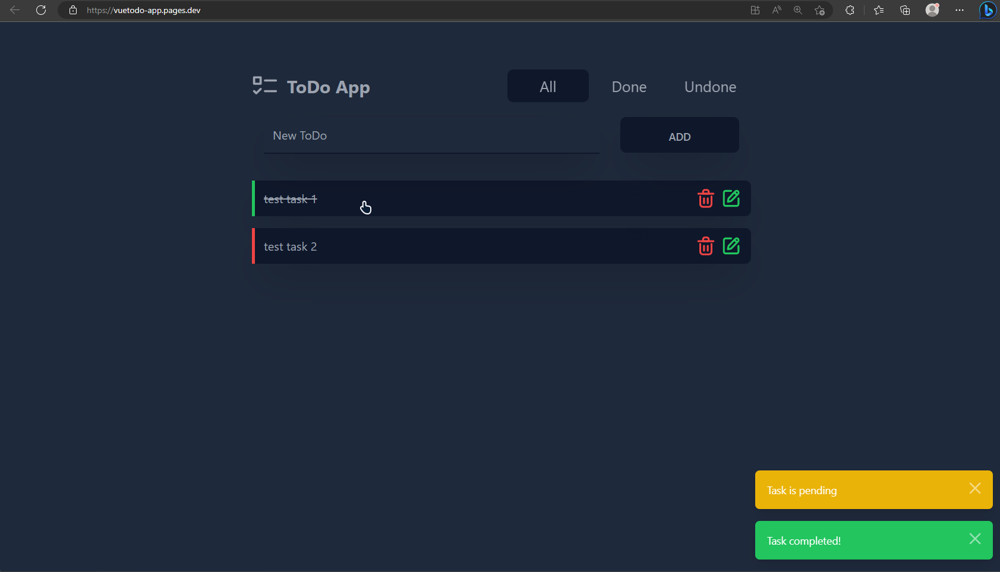
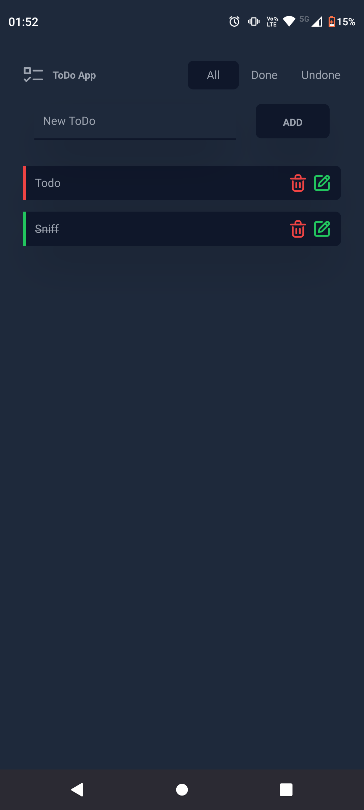

# ToDo App · Vue 3 + Tailwind CSS

> A lightweight, installable Progressive Web App for managing your daily tasks — built with Vue 3 Composition API and Tailwind CSS in a single plain HTML file, with zero build tools required.

[](https://vuejs.org/)
[](https://tailwindcss.com/)
[](https://web.dev/progressive-web-apps/)
[](LICENSE)

**[→ Live Demo](https://vuetodo-app.pages.dev/)**

---

## Features

| Feature                      | Details                                                     |
| ---------------------------- | ----------------------------------------------------------- |
| ✅ Add / Edit / Delete tasks | Full CRUD with inline editing                               |
| 🏷️ Flag tasks                | Mark as Daily, Monthly or Unscheduled with color indicators |
| 🔀 Drag & drop reorder       | Custom touch-friendly drag-and-drop with persistent order   |
| 🗂️ Filter by status          | View All, Done, or Undone tasks                             |
| 🎨 Dark / Light theme        | Respects system preference, persists to localStorage        |
| 📦 Data portability          | Export / import your task list via base64 encoded strings   |
| 📲 Installable (PWA)         | Works offline, installable on desktop and mobile            |
| 🔔 Toast notifications       | Non-intrusive feedback for every action                     |

---

## Screenshots

### Desktop



### Mobile



---

## Tech Stack

- **[Vue 3](https://vuejs.org/)** (Composition API via CDN) — reactive state, components, and watchers
- **[Tailwind CSS](https://tailwindcss.com/)** (CDN) — utility-first styling with dark mode support
- **Service Worker** — caches assets for offline use
- **localStorage** — persists tasks and theme preference with automatic data migration
- **No build step** — open `index.html` and it just works

---

## Getting Started

```bash
# Clone the repository
git clone https://github.com/caiquegaspar/todoapp-vuetailwind.git

# Enter the folder
cd todoapp-vuetailwind

# Open directly in browser (no server needed for basic use)
open index.html

# Or serve locally for PWA features (service worker requires HTTPS or localhost)
npx serve .
# then open http://localhost:3000
```

> **Note:** The Service Worker (required for offline support and PWA installation) only activates when served over `localhost` or HTTPS. Opening the file directly via `file://` will skip it.

---

## Project Structure

```
todoapp-vuetailwind/
├── index.html          # Entire application (Vue app, styles, logic)
├── manifest.json       # PWA manifest
├── serviceWorker.js    # Offline caching
├── assets/             # Icons for all platforms (PWA)
└── README.md
```

---

## Data Portability

The app supports exporting and importing your task list as a portable base64 string.

Access it by navigating to `/?access-data` in your browser:

- **Get Data** — encodes your current tasks and copies them to clipboard
- **Insert Data** — paste a previously exported string to restore your tasks

This is useful for migrating data between devices without a backend.

---

## Contributing

Issues and pull requests are welcome. For major changes, please open an issue first.

---

## License

[MIT](LICENSE) © [Caíque Gaspar](https://caiquegaspar.pages.dev)
